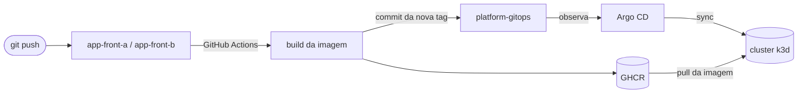

# platform-gitops


Laboratório pessoal para estudar e praticar **Kubernetes** e **GitOps**.

A ideia é reproduzir em escala pequena como uma empresa organiza a entrega de aplicações:
os apps ficam em repositórios separados, cada um com seu próprio CI, e este repositório é
a **fonte da verdade** do que roda no cluster. O **Argo CD** observa este repo e mantém o
cluster igual ao que está no Git.

> 🧪 Projeto de estudo: tudo roda localmente em um cluster k3d. Os apps são simples de
> propósito, porque o foco é a infraestrutura.

## Repositórios

| Repo | Papel |
|------|-------|
| **[platform-gitops](https://github.com/AlecKnipphoffDaCruz/platform-gitops)** (este) | Cluster local, instalação do Argo CD e manifests de todos os apps |
| **[app-front-a](https://github.com/AlecKnipphoffDaCruz/app-front-a)** | Front em React + Vite, servido por nginx. Dockerfile e CI |
| **[app-front-b](https://github.com/AlecKnipphoffDaCruz/app-front-b)** | Segundo front, com a mesma estrutura, para praticar múltiplos apps |

## Como funciona



1. Um push na `main` de um app dispara o CI
2. O CI builda a imagem e publica no GitHub Container Registry com a tag `sha-<commit>`
3. O CI commita a nova tag no overlay do app aqui no `platform-gitops`
4. O Argo CD detecta a mudança e aplica no cluster, sem nenhum `kubectl` manual

O Argo usa o padrão **App of Apps**: `argocd/root-app.yaml` é uma Application que cria as
outras Applications definidas em `argocd/apps/`. Para colocar um app novo no cluster, basta
adicionar um arquivo nessa pasta.

## Stack

- **k3d**: cluster Kubernetes (k3s) em containers Docker, com 1 server e 2 agents
- **Traefik**: Ingress Controller (já vem no k3s)
- **Argo CD v3**: entrega contínua via GitOps, com `prune` e `selfHeal` ligados
- **Kustomize**: `base` + `overlays` por ambiente
- **GitHub Actions + GHCR**: build e publicação das imagens

## Estrutura

```
bootstrap/
  k3d-cluster.yaml      # definição do cluster local
  argocd/               # instalação do Argo CD (versão fixa) + ingress da UI
argocd/
  root-app.yaml         # App of Apps
  apps/                 # uma Application por app/ambiente
apps/
  front-a/
    base/               # Deployment, Service, Ingress
    overlays/dev/       # namespace, réplicas e tag da imagem do ambiente dev
  front-b/
```

## Rodando localmente

Pré-requisitos: Docker, `kubectl`, [`k3d`](https://k3d.io) e [`gh`](https://cli.github.com).

```bash
make up                # cria o cluster e instala o Argo CD
make argocd-password   # senha do usuário admin
make root-app          # liga o App of Apps
```

| URL | O que é |
|-----|---------|
| http://argocd.localhost | UI do Argo CD |
| http://front-a.localhost | Front A |
| http://front-b.localhost | Front B |

Outros comandos: `make help`, `make status`, `make clone-apps`, `make build-apps`, `make down`.

## Roadmap

- [x] Cluster local com k3d e Ingress
- [x] Deploy com Kustomize (base + overlay dev)
- [x] Argo CD com App of Apps, sync automático, prune e self-heal
- [x] Repositórios separados para os apps
- [ ] CI fechando o ciclo GitOps (push no app → deploy automático)
- [ ] ConfigMap, Secret, HPA e PodDisruptionBudget
- [ ] Ambiente `prod` (novo overlay + Application)
- [ ] Observabilidade com Prometheus + Grafana
- [ ] Gestão de segredos com Sealed Secrets ou External Secrets
- [ ] NetworkPolicy isolando os apps
- [ ] Deploy canary com Argo Rollouts
- [ ] Argo CD gerenciando a própria instalação
